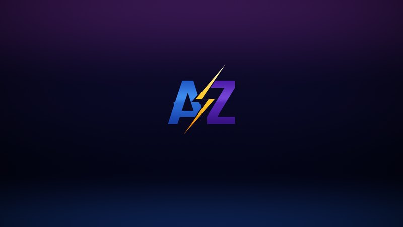
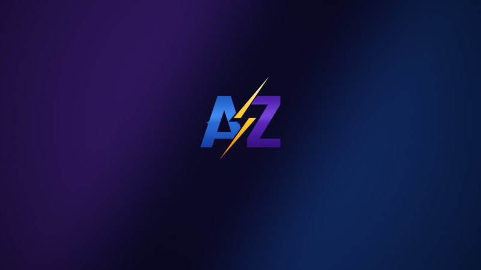

<h1 align="center">AZIZ Gaming Optimizer</h1>

One click: lower latency, steadier FPS, RAM use down to 1.6–2.5 GB and 40–60 background processes instead of 150+. Windows 10 / 11 · x64 · free

  <a href="https://github.com/z3tbz/AZIZ-Gaming-Optimizer/raw/main/AZIZ-Gaming-Optimizer-1.9.7.zip"><b>⬇ Download AZIZ Gaming Optimizer 1.9.7</b></a>
  &nbsp;·&nbsp;
  <a href="https://github.com/z3tbz/AZIZ-Gaming-Optimizer/raw/main/AZIZ-AME-1.9.6.apbx">AME Wizard playbook</a>
  &nbsp;·&nbsp;
  <a href="https://z3tbz.github.io/AZIZ-Gaming-Optimizer/">Website</a>

## How to download

1. Click **Download AZIZ Gaming Optimizer 1.9.7** above.
2. Extract the whole zip.
3. Run `AZIZGamingOptimizer.exe` as administrator.

Using AME Wizard? Download the **AME Wizard playbook** and open it in AME Wizard.

Only the latest version can be downloaded. Older versions are listed in [Releases](https://github.com/z3tbz/AZIZ-Gaming-Optimizer/releases) as a history of the project.

## AZIZ wallpapers

| Horizon (official) | Split |
|---|---|
|  |  |
| [⬇ Download 4K](https://github.com/z3tbz/AZIZ-Gaming-Optimizer/raw/main/wallpapers/AZIZ-Horizon-3840x2160.png) | [⬇ Download 4K](https://github.com/z3tbz/AZIZ-Gaming-Optimizer/raw/main/wallpapers/AZIZ-Split-3840x2160.png) |

Horizon is the official AZIZ wallpaper: Optimize sets it automatically at your exact screen resolution. Split is available in Settings. The 4K files fit any screen.

## What's new in 1.9.7

One-click Optimize with two profiles (Ultra Low Latency and Low Latency), new logo and identity, automatic RAM cleaner, exact live state for every control with details, updated Recommended services, NoSteamWebHelper, DX11 Fullscreen, AZIZ wallpapers, new Scan & Debloat and a deep uninstaller.
