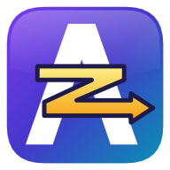

<h1 align="center">AZIZ Gaming Optimizer</h1>

Lower latency, steadier FPS and full control of Windows for gaming. Windows 10 / 11 · x64

  <a href="https://github.com/z3tbz/AZIZ-Gaming-Optimizer/raw/main/AZIZ-Gaming-Optimizer-1.9.6.zip"><b>⬇ Download AZIZ Gaming Optimizer 1.9.6</b></a>
  &nbsp;·&nbsp;
  <a href="https://github.com/z3tbz/AZIZ-Gaming-Optimizer/raw/main/AZIZ-AME-1.9.6.apbx">AME Wizard playbook</a>
  &nbsp;·&nbsp;
  <a href="https://z3tbz.github.io/AZIZ-Gaming-Optimizer/">Website</a>

## How to download

1. Click **Download AZIZ Gaming Optimizer 1.9.6** above.
2. Extract the whole zip.
3. Run `AZIZGamingOptimizer.exe` as administrator.

Using AME Wizard? Download the **AME Wizard playbook** and open it in AME Wizard.

Only the latest version can be downloaded. Older versions are listed in [Releases](https://github.com/z3tbz/AZIZ-Gaming-Optimizer/releases) as a history of the project.

## What's new in 1.9.6

See the [1.9.6 release notes](https://github.com/z3tbz/AZIZ-Gaming-Optimizer/releases/latest).
